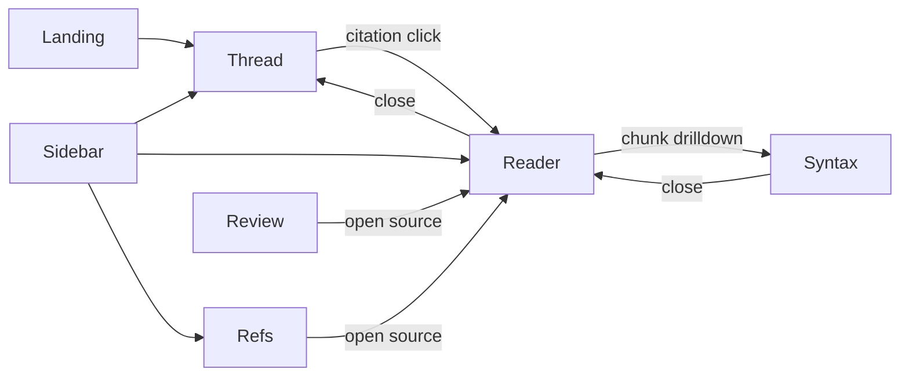
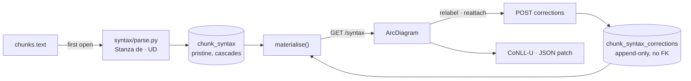

# Minerva application architecture

How the SolidJS frontend, HTTP API, and SQLite stores fit together.
For corpus ingest, see [INGESTION.md](INGESTION.md).

Editable diagram: [FigJam — Application Architecture](https://www.figma.com/board/3EXl1NgThKiIs2sBeEKHOz) — the
consolidated, ground-truth board (six lanes A–F, light and dark twins).
Update the relevant lane when the app changes. The older split boards
([App Flow](https://www.figma.com/board/9yBqT8fZSPFwcARJrnBy26), [Author Ingest Wave](https://www.figma.com/board/uaeZ5hqmEClhmBQf4Gv0xA)) are superseded
for a full-picture view and predate the `poietes → minerva` rename.

## Frontend routes

Hash-based routing ([`web/src/routing.ts`](../web/src/routing.ts)) — no pathname router, so the app works behind `minerva serve` on any path.

| Route | Screen |
|-------|--------|
| `#/` | Landing — new question |
| `#/c/:id` | Conversation thread + composer |
| `#/r/:work?lang=&focus=&term=` | Primary-source Reader |
| `#/syntax/:chunkId?work=` | Dependency-syntax close-reading overlay (German) |
| `#/refs?source=&target=&work=&type=` | Cross-references browser |
| `#/refs/review?source=&type=` | Curator review queue |
| `#/network`, `#/network/arc`, `#/network/coverage` | Citation network, chronological arc, coverage heatmap |
| `#/concordance`, `#/concordance/:lemma` | Concordance index and KWIC |

## Module conventions

**Frontend:** Feature folders use **single-file components (SFC)** — orchestrator
`index.tsx`, sibling `*.tsx` files (JSX + colocated hooks/helpers), feature-level
`.css`. No `hooks/` or `utils/` `.ts` trees under surfaces. Wire types in
[`web/src/api/types/`](../web/src/api/types/); UI types in
[`web/src/lib/uiTypes.ts`](../web/src/lib/uiTypes.ts). Routes live under
[`web/src/routes/`](../web/src/routes/). See [FRONTEND.md](FRONTEND.md).

**Backend:** Author metadata is authored in [`data/authors/manifest.yaml`](../data/authors/manifest.yaml) and codegen'd into `corpus_registry.py`, `author_ordering.py`, and `web/src/Landing/atlasData.ts` (`make generate-authors` / `make check-authors`). Corpus ingest is declarative via [`src/minerva/ingest/registry.py`](../src/minerva/ingest/registry.py). Per-author work tables live under [`src/minerva/authors/`](../src/minerva/authors/). Concordance SQL is split across `concordance/_scope.py`, `index_queries.py`, and `kwic_queries.py` (re-exported from `concordance/queries.py`). Domain chat logic uses [`ChatContext`](../src/minerva/chat_context.py) (not HTTP `ServerDeps`). `store/` and `agent/` are subpackages with `__init__` re-exports.

## UI composition

[`web/src/App.tsx`](../web/src/App.tsx) wires:

- **Sidebar** — Chat / Read / Refs tabs; conversation history; work list by author
- **Chat** — `Landing`, `Thread`, `Composer`; citations open Reader
- **Reader** — chunked text, translate/lookup rail, term glossary popovers, xref gutter
- **Refs** — filterable xref list; **Review** — triage `curator_status='auto'` rows
- **Syntax** — full-bleed dependency-tree overlay off the Reader, one chunk at a time

Cross-mode navigation:

### Syntax overlay

German only. The corpus knows what a word *is* (`chunk_lemmas`: form, lemma,
UPOS, feats) but nothing about how words hang together — no `head`, no
`deprel`, no sentence boundary. The overlay adds that layer, and because no
gold German treebank exists for philosophical prose, **correcting the parse is
the primary activity** rather than viewing it.

Three things about the shape are load-bearing:

- **The GET answers with the pristine parse and the correction log side by
  side**, not merged. Undo has to recompute the tree without one entry, which
  a merged tree cannot support. The client replays via
  `corrections/apply.ts`, the mirror of the server's `materialise`.
- **`chunk_syntax_corrections` has no foreign key, deliberately.** Hand
  corrections are the most expensive data the system holds and this repo has
  lost annotation to re-ingest three times; the table is in
  [`preserved_state.py`](../src/minerva/store/preserved_state.py) alongside the
  lemma and xref snapshots. `chunk_syntax` itself *does* cascade — it is
  reproducible machine output.
- **Colour encodes epistemic status**, the one thing the tool genuinely knows:
  `--syn-corr` hand-corrected, `--syn-mach` machine-parsed, `--syn-oxide`
  derived (the topological fields). Non-projective arcs are not a different
  hue — they render *below* the row, so position carries the discontinuity.

Geometry lives in [`web/src/Syntax/layout/`](../web/src/Syntax/layout/) and is
pure and unit-tested: `measure` (real `getComputedTextLength`, the repo's
first), `arcs` (levels, projectivity), `rows` (wrapping and cut arcs — the
median German sentence is 1328px wide and the worst is 5.4 screens), `fields`
(the topological-field heuristic), `minimap`.

See [syntax-annotation-plan.md](syntax-annotation-plan.md) for the derivation,
the two corrections to the source brief, and the known gaps.

## Data stores

| Path | Purpose |
|------|---------|
| `data/index.sqlite` | Corpus chunks, FTS5, embeddings, cross-references, term glossary, dependency parses |
| `data/conversations.sqlite` | Chat threads and messages |
| `data/translations.sqlite` | On-demand translation cache |
| `data/concept_cache.sqlite` | Concept-expansion lookup cache |

All default paths are overridable on `minerva serve` (see `cli/_shared.py`).

Corpus metadata (slugs, languages, citation systems, chat keywords) is defined in
[`src/minerva/corpus_registry.py`](../src/minerva/corpus_registry.py).

## HTTP API

Stdlib server in [`src/minerva/server.py`](../src/minerva/server.py). Run via `minerva serve`.

### Chat and conversations

| Method | Path | Purpose |
|--------|------|---------|
| `POST` | `/api/chat` | Grounded answer; optional SSE when `stream: true` |
| `GET` | `/api/conversations` | List conversations |
| `GET` | `/api/conversations/:id` | Fetch one + messages |
| `DELETE` | `/api/conversations/:id` | Hard delete |

### Reader

| Method | Path | Purpose |
|--------|------|---------|
| `GET` | `/api/works` | Works list (chronological author order) |
| `GET` | `/api/works/:work` | Chunk window; `around=<chunk_id>` for citation focus |
| `GET` | `/api/chunks/:id/context` | Full chunk + neighbors (margin notes) |
| `GET` | `/api/words/lookup` | Word → lemma (glossary) |
| `POST` | `/api/translate` | Selection translation |

### Terms

| Method | Path | Purpose |
|--------|------|---------|
| `GET` | `/api/terms` | Term list (filtered) |
| `GET` | `/api/terms/:id` | One term |
| `GET` | `/api/terms/by_chunk/:chunk_id` | Terms in chunk |
| `GET` | `/api/works/:id/term_occurrences` | Occurrences for a work |
| `GET` | `/api/works/:id/occurrence_map` | Occurrence map |
| `GET` | `/api/works/:id/lemma_highlights` | Lemma highlight ranges |
| `GET` | `/api/translations/:id/renderings` | Translation renderings |

### Syntax

| Method | Path | Purpose |
|--------|------|---------|
| `GET` | `/api/chunks/:id/syntax` | Pristine parse + correction log; parses on first call |
| `POST` | `/api/chunks/:id/syntax/corrections` | Append one `head` or `deprel` correction |
| `DELETE` | `/api/syntax/corrections/:id` | Undo one correction |

The `GET` is rate-limited (`_RATE_LIMITS` in `http/server_core.py`) because an
uncached parse is CPU-bound: ~4.3 s to load the Stanza pipeline once per
process, then ~0.15 s per paragraph. `minerva syntax parse --work <id>` warms a
whole work into the same table, so a warmed chunk is simply a cache hit.

Deprels are validated twice, differently, on purpose: the client checks
membership of the 47-entry inventory (the picker is right there, and nothing
off-list should reach the wire), the server checks only the *shape*
`^[a-z]+(:[a-z]+)?$` — duplicating the inventory across two languages would
mean two lists to keep in step. The shape check is what stops a TIGER label or
a paste from reaching storage.

### Cross-references

| Method | Path | Purpose |
|--------|------|---------|
| `GET` | `/api/chunks/:id/references` | Outgoing + incoming for Reader gutter |
| `GET` | `/api/works/:id/references_map` | Windowed map for gutter markers |
| `GET` | `/api/references` | Corpus-wide list (`/refs` UI) |
| `GET` | `/api/references/sources` | Source author facet |
| `GET` | `/api/references/review_queue` | Curator queue |
| `PATCH` | `/api/references/:id` | Approve / reject / edit |

### Other

| Method | Path | Purpose |
|--------|------|---------|
| `GET` | `/api/health` | Stats + configured LLM backend |
| `GET` | `*` (non-API) | Static SPA from `--static` (default `web/dist`) |

## `minerva serve` behavior

From [`src/minerva/cli/serve_cmd.py`](../src/minerva/cli/serve_cmd.py):

- **`--lang any`** (default) — retrieval searches every language in the index
- **Auto hybrid retrieval** — loads the sentence-transformer embedder when embeddings exist in the index (no `--use-vectors` flag needed on serve)
- **Concept expand** — on by default; uses `concept_cache.sqlite`; disable with `--no-concept-expand`
- **Query rewrite** — on by default (`--no-auto-rewrite` to disable); client can also force rewrite
- **Separate DB paths** — `--db`, `--conversations-db`, `--translations-db`, `--concept-cache-db`

Local dev: `make run` starts the API on `:8000` and Vite on `:5173`.
Production: `make start` builds `web/dist` and serves API + bundle on one port.

## CLI (corpus operator)

Top-level commands via `minerva` ([`src/minerva/cli/__init__.py`](../src/minerva/cli/__init__.py)):

`ingest`, `index`, `embed`, `ask`, `chat`, `stats`, `serve`, `eval`, plus `terms`, `refs` and `syntax` subcommands.

`minerva syntax parse --work <id>` warms a whole work's dependency parses into
`chunk_syntax` in bulk. It writes the same table the endpoint reads, so warming
and parse-on-demand are the same cache, not two paths.
